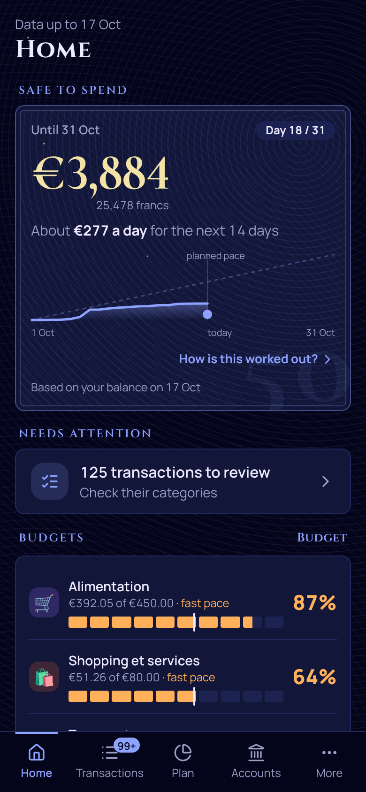
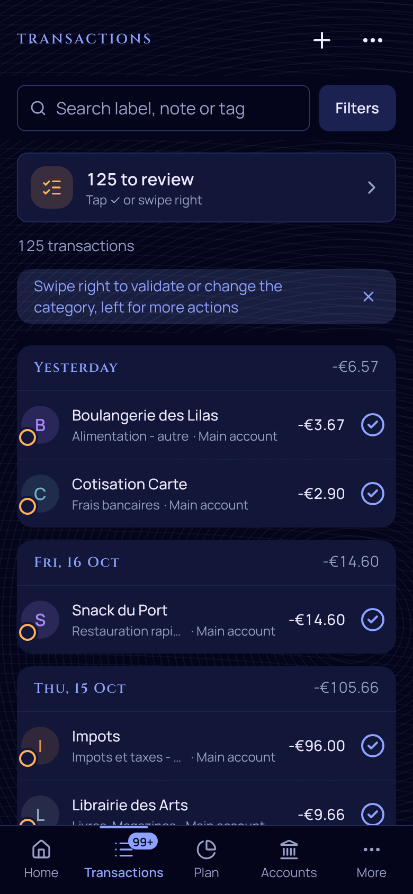
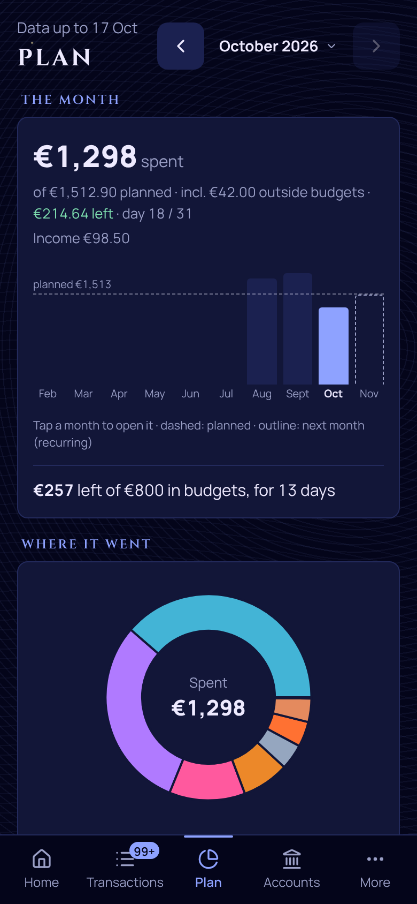
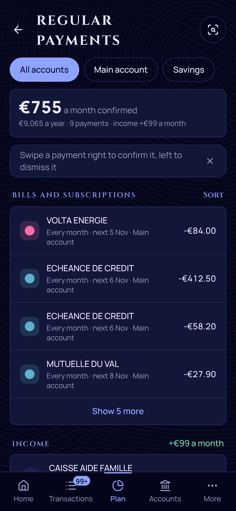
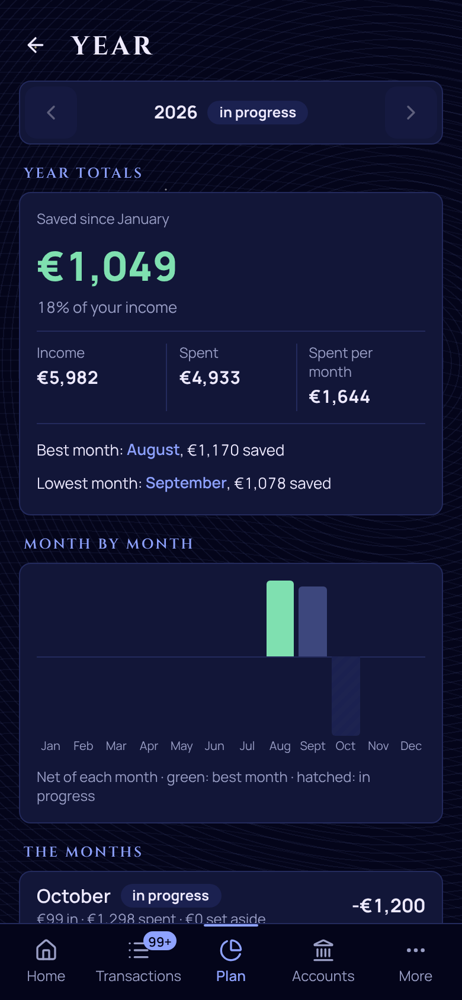
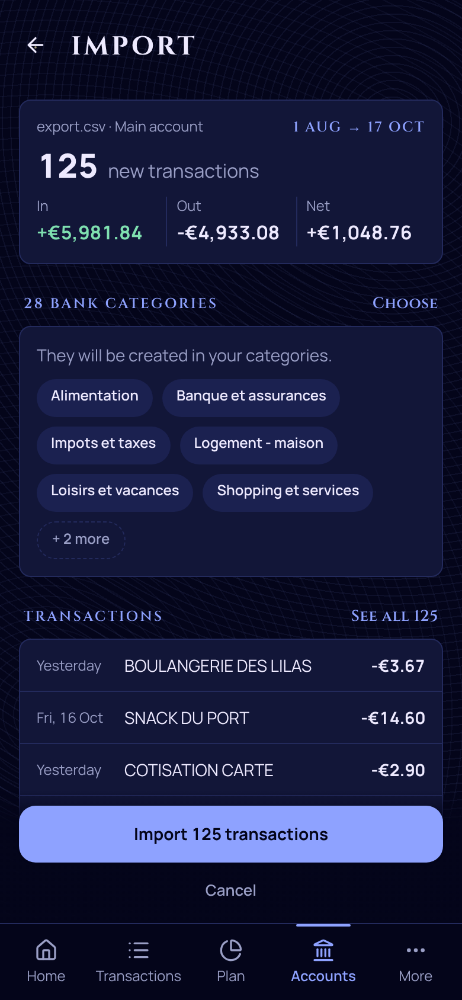
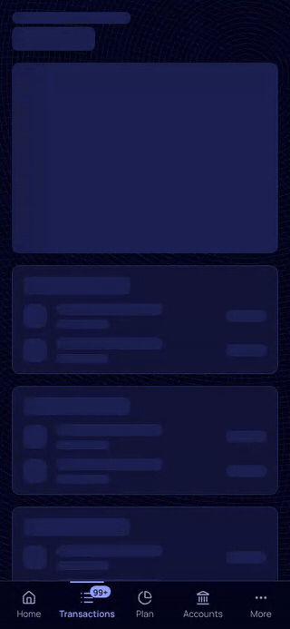

<p align="center"></p>

<h1 align="center">franC</h1>

<p align="center"><em>Pas mal, non ? C'est franC.</em></p>

<p align="center">
A personal budget app for your phone: import your bank's CSV (or sync it), sort your spending with a swipe,
and always know what is left to spend this month.
</p>

<p align="center">
  <a href="LICENSE"></a>
  <a href="https://github.com/jdesaintdenis/franC/actions/workflows/e2e.yml"></a>
  
</p>

<p align="center">
  
  
  
</p>
<p align="center">
  
  
  
</p>

*All screens are the real app running on a synthetic sample export, in the dark 50 F look.*

## What franC does

franC is a budget app made for a phone. You bring in your bank transactions, sort them with a swipe, and the home screen tells you one thing: **how much you can still spend this month**, after the bills that are coming.

- **See what is left.** The amount to spend until the end of the month, with a small chart that shows if you are ahead or behind. A wink for nostalgic people: the same sum in old French francs.
- **Sort in seconds.** Swipe a transaction to the right to confirm its category. franC learns your habits and suggests categories, so most of the work is already done.
- **Budgets that make sense.** Give each category a monthly limit and watch it fill up. Bills you pay every month are counted, so the gauge tells the truth.
- **Regular payments, found for you.** Subscriptions and bills are spotted automatically, and you are told when a price goes up.
- **Savings goals and loans.** Follow a goal on its way to the target, or see how much of a loan is left to repay.
- **Look back on the year.** What came in, what went out, and where the money went, month by month.
- **Bring your data in your way.** Upload your bank's CSV file (checked before anything is saved, never duplicated), or connect your bank to sync it ([how to set up bank sync](docs/deployment.md#bank-sync-with-enable-banking-optional)).
- **Your data stays yours.** You run franC yourself, on your own database. Nothing is shared with anyone.
- **Works like an app.** Install it on your phone's home screen. It speaks English and French.

## Categorize in seconds

<p align="center"></p>

## Try it

You need a computer with Node and Docker. Then:

```bash
git clone https://github.com/jdesaintdenis/franC.git
cd franC
pnpm setup
pnpm dev
```

Open http://localhost:3000, create your account, and import [`docs/samples/sample-export.csv`](docs/samples/sample-export.csv) to see franC with made-up data.

More help: [run it on your computer or server](docs/self-hosting.md) · [put it online for free with Vercel and Neon](docs/deployment.md) · [every setting (environment variables)](docs/deployment.md#3-environment-variables).

franC reads one bank's CSV format today (the sample file shows it). Other banks can be added, or connected through bank sync.

## License

MIT, see [`LICENSE`](LICENSE). Found a security problem? See [`SECURITY.md`](SECURITY.md).
